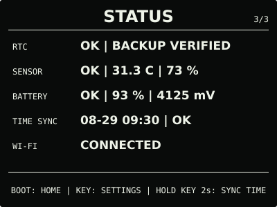
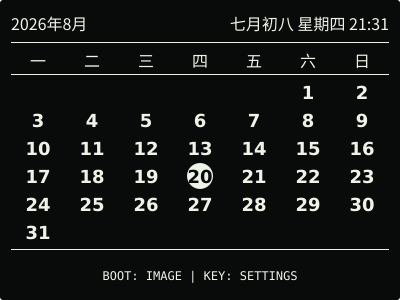
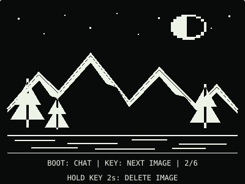
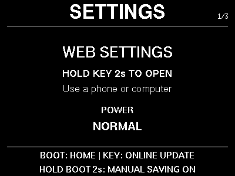
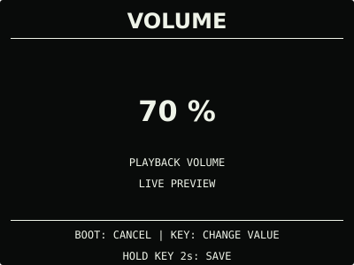
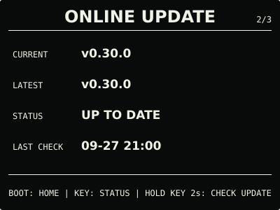

# ESP32 RLCD Firmware v0.30.0

音乐增加循环播放和定时停止；日常页面可按需显示，天气保存与网页设置操作更连贯。

## 效果预览

| 首屏 | 天气 |
| :---: | :---: |
|  |  |
| 市场看板 | 状态 |
|  |  |
| 月历 | microSD 图片 |
|  |  |
| microSD 音乐 | 对话 |
|  |  |
| 设置 | 音量 |
|  |  |
| 闹钟 | 在线更新 |
|  |  |

400 × 300 黑底白字，示例内容不是实时数据。全反射屏的实际观感随环境光变化。

## 主要变化

- 网页“媒体 → 播放设置”支持顺序播放、单曲循环和列表循环，独立保存，不打断当前歌曲。
  定时停止可选 15、30、60、90 分钟或取消；暂停期间继续计时，切歌不重置。
  手动停止、播放错误、闹钟/对话等抢占后取消，重启不恢复倒计时。
- 网页“常用 → 显示页面”可选择天气、市场、月历、图片、音乐、对话是否出现在日常页面中。
  顺序固定，时钟与维护入口保留；隐藏不删除文件或配置，也不停止后台音乐。
- 保存天气后留在网页，可继续设置其他项目；关闭门户后获取，不重启、不强制跳页。
- 网页读取失败可原地重试，其他表单草稿保留。保存断线或超时时提示核对设备状态，
  不自动重复提交；本地 OTA 断线后先查看屏幕，重新开启门户核对版本，再决定是否重试。

设备不增加菜单或按键组合。操作说明见[设备设置](../../docs/device-settings.md)与
[microSD 音乐播放](../../docs/music-player.md)。

## 选择文件

| 文件 | 用途 | 大小 |
| --- | --- | ---: |
| `esp32-rlcd-firmware-v0.30.0-factory.bin` | 首次安装与完整恢复，从 0x0 写入并清除配置 | 8.56 MB |
| `esp32-rlcd-firmware-v0.30.0-ota.bin` | 日常应用更新，保留 Wi-Fi、API Key 和设备偏好 | 2.23 MB |
| `esp32-rlcd-firmware-v0.30.0-model.bin` | 旧设备通过 USB 补装离线语音模型 | 2.20 MB |

MB 按 1,000,000 字节换算，摘要见 [SHA256SUMS](SHA256SUMS)。Factory 包含 Bootloader、
分区、应用和语音模型；OTA 只更新应用。已有兼容模型时无需重写模型，也无需重新配网。

## 安装使用

在 `ONLINE UPDATE` 按住 KEY 2 秒检查，看到 v0.30.0 后松开，再按住 3 秒安装。
v0.27.0 及更早版本还需按提示长按 2 秒进入确认页。没有互联网时，打开网页设置并切换
设备热点，在“维护 → 本地固件更新”上传 OTA。

```sh
cd dist/v0.30.0
sha256sum --check SHA256SUMS
```

首次安装与旧版迁移见[发布固件安装指南](../../docs/user-install.md)，更新与恢复见
[固件安装与更新](../../docs/firmware-update.md)。

## 验证与兼容

2026-09-27，用户确认 dev.2 使用正常并同意发布。正式版沿用相同功能源码；OTA 与候选
等长，仅 75 字节的版本、构建信息和镜像校验字段不同。固定 ESP-IDF v5.5.3 构建、
主机测试、字体布局、网页模拟、仓库与许可检查通过；分区和离线语音模型不变。

偏好迁移到 schema v10，保留原有偏好和旧记录；从 dev.2 更新不需要再次迁移。
若回退 v0.29.0 或 dev.1，旧版会使用默认偏好并拒绝覆盖新格式，重新升级可恢复新版偏好。
这不清除 Wi-Fi、天气等独立配置，详见[升级与回退](../../docs/v0.30-plan.md#升级与回退)。

天气、市场看板和 AI 对话继续保留 Beta。长时间播放、定时截止与抢占联合操作、真实断电、
跨版本回退和网络异常等专项继续记录在[版本验证记录](../../docs/v0.30-plan.md)，
不将整体使用反馈等同于全部专项通过。

许可证与第三方材料见 [LICENSE](../../LICENSE)、[NOTICE.md](../../NOTICE.md) 和
[LICENSES](../../LICENSES/)。
