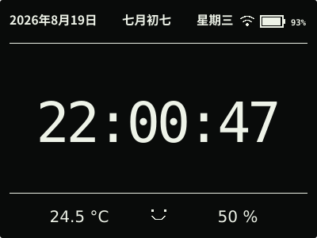
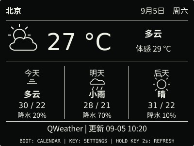
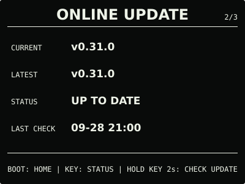

# ESP32 RLCD Firmware v0.31.0

AI 对话迁移到 Qwen Audio 3.0 Realtime Flash，并完善连接失败提示与网页诊断。

## 效果预览

| 首屏 | 天气 |
| :---: | :---: |
|  |  |
| 市场看板 | 状态 |
|  |  |
| 月历 | microSD 图片 |
|  |  |
| microSD 音乐 | 对话 |
|  |  |
| 设置 | 音量 |
|  |  |
| 闹钟 | 在线更新 |
|  |  |

400 × 300 黑底白字，示例内容不是实时数据。本版不改变日常页面布局。

## 主要变化

- 默认模型改为 `qwen-audio-3.0-realtime-flash`，自动迁移旧模型配置，保留 API Key、Host 和开关。
- 对话失败显示简短原因与处理建议；服务端提前关闭连接时及时结束，不再一直等待后误报超时。
- 设置门户显示当前模型与最近对话结果，失败时可展开连接阶段和关闭码；不显示凭据或对话内容。
- 保存配置不等于连接成功，也不会自动发起收费测试。最近结果仅保存在本次启动的内存中。

**升级后，请在百炼对应地域、业务空间中确认 API Key 已获新模型的调用权限。**
设备只能迁移模型名称，不能代为授权；仅授权过旧模型的 Key 可能无法调用新模型。
授权后无需重新刷写或重置 Wi-Fi。具体步骤见 [AI 对话设置](../../docs/cloud-voice.md)。

## 选择文件

| 文件 | 用途 | 大小 |
| --- | --- | ---: |
| `esp32-rlcd-firmware-v0.31.0-factory.bin` | 首次安装与完整恢复，从 0x0 写入并清除配置 | 8.56 MB |
| `esp32-rlcd-firmware-v0.31.0-ota.bin` | 日常应用更新，保留 Wi-Fi、API Key 和设备偏好 | 2.23 MB |
| `esp32-rlcd-firmware-v0.31.0-model.bin` | 旧设备通过 USB 补装离线语音模型 | 2.20 MB |

MB 按 1,000,000 字节换算，摘要见 [SHA256SUMS](SHA256SUMS)。Factory 包含 Bootloader、
分区、应用和离线语音模型；OTA 只更新应用，已有兼容模型时无需重写模型或重新配网。

## 安装使用

在 `ONLINE UPDATE` 按住 KEY 2 秒检查，看到 v0.31.0 后松开，再按住 3 秒安装。
v0.27.0 及更早版本还需按提示长按 2 秒进入确认页。没有互联网时，打开网页设置并切换
设备热点，在“维护 → 本地固件更新”上传 OTA。

```sh
cd dist/v0.31.0
sha256sum --check SHA256SUMS
```

首次安装见[发布固件安装指南](../../docs/user-install.md)，更新与恢复见
[固件安装与更新](../../docs/firmware-update.md)。

## 验证与兼容

2026-09-28，用户确认此前连接失败是新模型未授权，授权后 dev.2 测试正常并同意发布。
正式版沿用相同功能源码；OTA 与候选等长，仅 75 字节的版本、构建信息和镜像校验字段不同。
固定 ESP-IDF v5.5.3 构建、全套主机测试通过，分区、离线模型与配置格式不变。
本次没有通过 USB 写入设备，也没有代用户调用云端模型。

天气、市场看板和 AI 对话继续保留 Beta。其他地域、断网、长回复、多轮边界、真实断电迁移
和连续资源回收等专项仍待逐项验证，详见 [v0.31.0 验证记录](../../docs/v0.31-plan.md)。

许可证与第三方材料见 [LICENSE](../../LICENSE)、[NOTICE.md](../../NOTICE.md) 和
[LICENSES](../../LICENSES/)。
