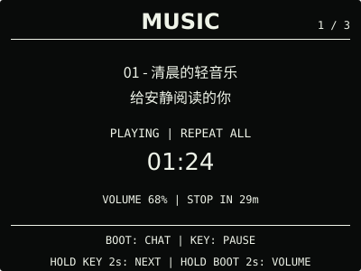
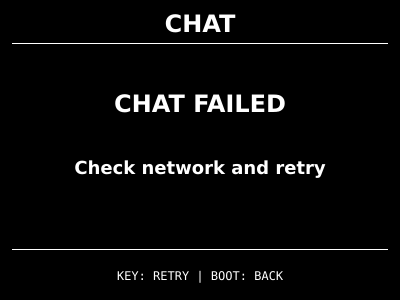

# ESP32 RLCD Firmware v0.33.0

新增倒计时与秒表，让图片取景更方便，日历未校时也能继续导航。

## 效果预览

| 首屏 | 天气 |
| :---: | :---: |
|  |  |
| 市场看板 | 月历 |
|  |  |
| 倒计时 | 秒表 |
|  |  |
| microSD 图片 | microSD 音乐 |
|  |  |
| 对话 | 对话重试 |
|  |  |
| 设置 | 状态 |
|  |  |

400 × 300 黑底白字，示例内容不是实时数据。页脚随所选页面顺序调整。

## 主要变化

- 新增可隐藏、可排序的计时页，倒计时与秒表独立运行；切页继续，不依赖 RTC、网络或 microSD。
- 倒计时开机初始选 5 分钟。短按 KEY 循环 1/5/10/30 分钟及不重复的网页自定义值，
  最多五档；按住 KEY 2 秒开始。运行/暂停时短按暂停/继续，长按重置并保留所选时长；
  完成后短按仅回选择态，不自动重开。
- 按住 BOOT 2 秒切模式，短按仍切下一页。秒表短按开始/暂停/继续，长按 KEY 2 秒归零，
  在 `99:59:59` 封顶；重启后两个计时都不自动恢复。
- 网页独立保存 1–180 分钟的自定义候选，默认 5 分钟；保存不改当前选择或计时状态。
  已保存的 25 分钟等旧自定义值继续保留。
- 倒计时完成按闹钟音量播放最长 3 秒提示声，0% 只显示屏幕；有声提醒停止音乐且不自动恢复。
  RTC 闹钟优先，忙碌事务期间最多等待 60 秒，过期不再补响。
- 图片导入默认“完整显示”，也可“铺满裁剪”并用鼠标或触摸拖动取景；底部 50 像素保留，
  JPEG/PNG 原图只在浏览器处理，不上传。
- 日历未校时或日期超出支持范围时保留校时建议、下一页和设置入口。

## 选择文件

| 文件 | 用途 | 大小 |
| --- | --- | ---: |
| `esp32-rlcd-firmware-v0.33.0-factory.bin` | 首次安装与完整恢复，从 0x0 写入并清除配置 | 8.56 MB |
| `esp32-rlcd-firmware-v0.33.0-ota.bin` | 日常应用更新，保留 Wi-Fi、API Key 和设备偏好 | 2.27 MB |
| `esp32-rlcd-firmware-v0.33.0-model.bin` | 旧设备通过 USB 补装离线语音模型 | 2.20 MB |

MB 按 1,000,000 字节换算，摘要见 [SHA256SUMS](SHA256SUMS)。Factory 包含 Bootloader、
分区、应用和离线模型；OTA 只更新应用，已有兼容模型时无需重写或重新配网。

## 安装使用

在 `ONLINE UPDATE` 按住 KEY 2 秒检查，看到 v0.33.0 后松开，再按住 3 秒安装。
v0.27.0 及更早版本还需按提示长按 2 秒进入确认页。没有互联网时，打开网页设置并切换
设备热点，在“维护 → 本地固件更新”上传 OTA。

```sh
cd dist/v0.33.0
sha256sum --check SHA256SUMS
```

首次安装见[发布固件安装指南](../../docs/user-install.md)，更新与恢复见
[固件安装与更新](../../docs/firmware-update.md)。

## 验证与兼容

2026-10-03，用户确认 dev.2 整体使用正常并同意发布。正式版的 `src/`、`tests/` 与 dev.2
一致，固定 ESP-IDF v5.5.3 正式构建及全套主机测试通过。正式 OTA 与候选等长，仅 75 字节
的版本、构建信息和镜像校验字段不同；分区与离线语音模型不变。

设置迁移到 schema 12，保留原偏好、凭据和卡文件。旧六页显隐与顺序不变，计时追加末尾；
旧页面全隐藏时仍只显示时钟，其他旧配置新增计时入口。新装或恢复默认时，计时位于日历之后。
从 dev.2 升级不再次迁移设置，不建议在新旧版本间反复降级修改偏好。

用户整体反馈不代替逐项专项实测；长期运行、真实断电、提醒与其他事务交接，以及不同
浏览器触摸仍单独跟踪，详见 [v0.33.0 验证与发布记录](../../docs/v0.33-plan.md)。
天气、市场看板和 AI 对话继续保留 Beta。

许可证与第三方材料见 [LICENSE](../../LICENSE)、[NOTICE.md](../../NOTICE.md) 和
[LICENSES](../../LICENSES/)。
