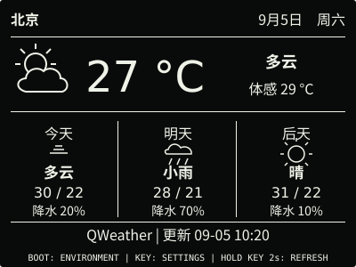
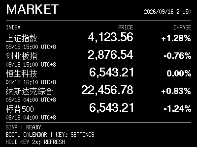
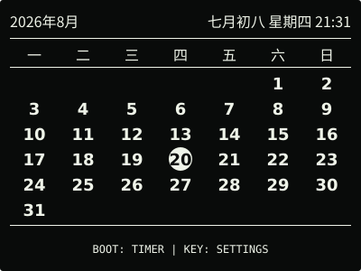
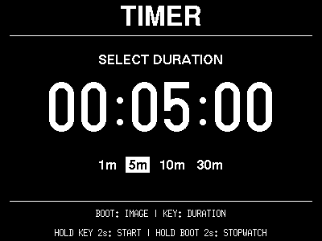
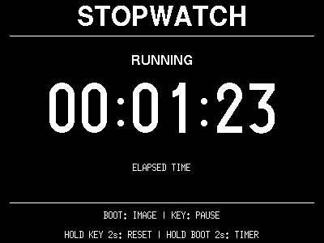
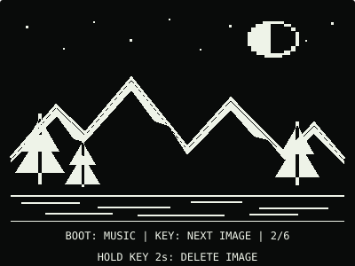
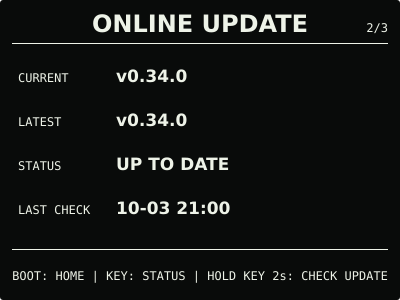

# ESP32 RLCD Firmware v0.34.0

新增室内环境趋势、可选 SD 历史记录和普通偏好备份，并提供双键快捷返回主屏。

## 效果预览

| 首屏 | 环境趋势 |
| :---: | :---: |
|  |  |
| 天气 | 市场看板 |
|  |  |
| 月历 | 倒计时 |
|  |  |
| 秒表 | microSD 图片 |
|  |  |
| microSD 音乐 | 对话 |
|  |  |
| 设置 | 在线更新 |
|  |  |

400 × 300 黑底白字，示例内容不是实时数据。环境图展示从左侧增长的 12 小时记录；
各页底部目的地随页面显隐、顺序与功能可用性调整。

## 主要变化

- 新增 `ENVIRONMENT` 页，显示最近 24 小时温湿度趋势和最低、最高值。正常模式每
  30 秒采样、省电模式每 60 秒采样，每 5 分钟汇总；新曲线从左向右增长，满一天后滚动。
  缺失和关机区间留空，无网络、无卡或 RTC 未校准时仍记录本次开机的数据。
- 网页“常用 → 环境趋势”可查看曲线、下载 CSV，并选择 SD 最近 24 小时恢复或月度
  长期历史。保存默认关闭，旧短期保存选择不自动扩大为长期留存；卡空间不足停止写入，
  不自动删除旧记录。忙碌时延后，突然关机可能丢失尚未保存的数据。
- 网页“维护 → 偏好备份”支持导出 JSON，导入前预览并确认。仅包含普通偏好，不含
  Wi-Fi、API Key、外部服务配置和媒体文件，也不改变更新通道、省电或 SD 保存开关。
- 设置按分区更新最新值，避免交错操作覆盖其他偏好；失败保留原配置，成功无需重启。
- 普通页面同时短按 BOOT + KEY，完整松开后返回时钟，音乐和计时继续运行。升级、
  对话、提醒及其他临时操作仍按屏幕提示处理；原单键行为和 PWR 开关机不变。

使用方法见[环境记录与偏好备份](../../docs/environment-history.md)及
[界面与按键](../../docs/home-screen.md)。

## 选择文件

| 文件 | 用途 | 大小 |
| --- | --- | ---: |
| `esp32-rlcd-firmware-v0.34.0-factory.bin` | 首次安装与完整恢复，从 0x0 写入并清除配置 | 8.56 MB |
| `esp32-rlcd-firmware-v0.34.0-ota.bin` | 日常应用更新，保留 Wi-Fi、API Key 和设备偏好 | 2.32 MB |
| `esp32-rlcd-firmware-v0.34.0-model.bin` | 旧设备通过 USB 补装离线语音模型 | 2.20 MB |

MB 按 1,000,000 字节换算，摘要见 [SHA256SUMS](SHA256SUMS)。Factory 包含 Bootloader、
分区、应用和离线模型；OTA 只更新应用，已有兼容模型时无需重写模型或重新配网。

## 安装使用

在 `ONLINE UPDATE` 按住 KEY 2 秒检查，看到 v0.34.0 后松开，再按住 3 秒安装。
v0.27.0 及更早版本还需按提示长按 2 秒进入确认页。没有互联网时，打开网页设置并切换
设备热点，在“维护 → 本地固件更新”上传 OTA。

```sh
cd dist/v0.34.0
sha256sum --check SHA256SUMS
```

首次安装见[发布固件安装指南](../../docs/user-install.md)，更新与恢复见
[固件安装与更新](../../docs/firmware-update.md)。

## 验证与兼容

2026-10-14，用户确认 dev.4 使用正常并授权发布。正式版沿用同一功能源码与测试，
固定 ESP-IDF v5.5.3 构建和全套主机测试通过。正式 OTA 与候选等长，仅 76 字节的
版本、构建时间、ELF 摘要和镜像校验字段不同；分区与离线模型不变。

通用设置迁移到 schema 14，保留原偏好、凭据和卡文件。八个可选日常页支持隐藏和排序；
升级保留原七页顺序并在末尾追加环境页，旧全隐藏配置不变。新装或恢复默认时，环境页
位于天气之后。旧 v13 的短期 SD 保存授权继续保留，长期历史默认关闭；从 dev.4 升级
不再次迁移设置。不建议在新旧版本间反复降级修改偏好。

用户整体反馈不代替长期运行、真实断电、慢卡和异常并发等专项实测，验证边界见
[v0.34.0 记录](../../docs/v0.34-plan.md)。天气、市场看板和 AI 对话继续保留 Beta。

许可证与第三方材料见 [LICENSE](../../LICENSE)、[NOTICE.md](../../NOTICE.md) 和
[LICENSES](../../LICENSES/)。
