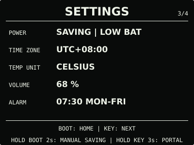

# 设备设置

以下操作对应正式 v0.33.0。设备端保留常用按键操作，较复杂的配置在网页完成。
计时页、图片拖动取景与日历未校时空态从 v0.33.0 起提供，旧版设备需先更新。

## 打开网页设置

1. 按屏幕提示用 `KEY` 切到 `SETTINGS`。
2. 按住 `KEY` **2 秒**，直接打开网页设置，不经过二级菜单。
3. 手机与设备连接同一家庭 Wi-Fi 时，扫描屏幕二维码即可进入。也可在浏览器打开屏幕
   显示的地址，再输入 8 位 `ACCESS CODE`。

没有可用家庭连接或处于省电模式时，使用设备热点：扫码连接，未自动打开网页时访问
`http://192.168.4.1`。热点不需要互联网，退出后按省电设置恢复家庭网络。

局域网连接使用 HTTP，仅限可信家庭网络，可修改普通偏好、校时和管理媒体，
也可修改天气开关、省市、官方 Host，以及 AI 开关、音色、风格、受支持模型与官方 Host，无需换网。
只有填写或更换天气、AI 的 API Key，以及修改 Wi-Fi、本地 OTA 等维护操作需要设备热点；在设备短按 `KEY`，
或点击网页的“切换到设备热点”。不要做路由器端口映射或公开访问码、二维码。

每次开启都会更新授权；刷新网页后需重新扫码或输入访问码。浏览网页、切换分区与查看
歌单不会停止音乐；上传、删除或试听闹钟时会停止音乐，不会在结束后自动续播。

## 网页分区

| 分区 | 内容 |
| --- | --- |
| 常用 | 时区、温度单位、播放音量、手机时间校准；显示页面、计时与闹钟按需展开 |
| 联网 | 当前或已保存的 Wi-Fi；天气、市场看板与 AI 配置按需展开 |
| 媒体 | 歌曲管理、播放方式与定时停止；图片管理按需展开 |
| 维护 | Beta 更新开关、本地 OTA；恢复默认值单独展开并确认 |

常用、显示页面、计时、音乐播放方式、闹钟与更新设置分别保存；天气和 AI 的普通设置与 API Key 也分别保存。
切换分区不刷新表单，保存一项不清除其他未保存输入；
普通设置保存失败保留草稿，API Key 提交后清空输入框。保存不重启；AI 设置从下一次对话生效。
无 SD 卡时上传和播放不可用，但可保存播放方式，
其他功能不受影响。图片与音乐的详细操作见 [图片管理](microsd-images.md)和
[音乐播放](music-player.md)。

必要设置未读取成功前，对应表单保持禁用，可按提示原地重试，无需刷新整个网页。
保存超时或连接中断并不代表一定没保存，重新读取核对后再操作；不会自动重复提交。
本地 OTA 中断时先看设备屏幕，如需重试，重新开启设置并确认当前版本后再上传。

闹钟默认关闭，规则为工作日 07:30；开启前请确认 RTC 时间正确。闹钟使用独立音量，
0% 时只有屏幕提醒，媒体静音不影响它。升级沿用原音量，不突然变响。
“试听闹钟”播放最多 3 秒，不保存设置；调整后点击“保存闹钟”。

普通门户在闲置 5 分钟后关闭；输入和点击会续期，自动轮询不会。一次最多 30 分钟，
已开始的上传有独立的 10 分钟时限，不因跨过闲置期而中断。短按 `BOOT` 可关闭门户，
写卡或本地 OTA 期间不可中断。

## 页面显示与顺序

展开“常用 → 显示页面”，勾选天气、市场看板、月历、计时、图片、音乐和对话后独立保存。
新装默认全部勾选，全不选时只显示时钟。时钟固定第一位，其他七页用 ↑ ↓ 调整顺序后保存。
新装或恢复默认的顺序为天气、市场看板、日历、计时、图片、音乐、对话；升级保留旧六页
的显隐与排序，计时追加末尾。旧配置全隐藏时保持不变，其他旧配置默认新增计时入口。
隐藏或暂不可用的页面会跳过，但保留
排序位置；保存后无需重启，也不会切走仍可用的当前页面。不提供常驻页或自动返回。

勾选与功能是否可用分别判断：天气和市场还需在“联网”开启，图片和音乐还需有效文件。
隐藏只跳过设备页面，不删除文件或凭据，也不关闭后台服务、闹钟、音乐或已开始的计时。
要停止天气联网，应关闭天气功能，而不只是隐藏页面。

时钟、设置、在线更新、状态和启动恢复入口不可隐藏。当前页被隐藏时回到时钟；重新显示
页面不会自动切过去。页脚始终显示按键实际要去的页面，不指向隐藏项。

## 计时与秒表

“计时”是可隐藏和排序的日常页，不要求 RTC 有效、联网或插卡；隐藏入口不暂停已开始的计时。

倒计时开机初始选择 5 分钟，空闲时先在原页选时长，再明确长按开始；不会因为门户中
仍保存旧 25 分钟或其他自定义值就自动选用。设备端操作如下：

- 倒计时选择态短按 `KEY` 循环 1、5、10、30 分钟，以及不重复的门户自定义值，最多
  五档；按住 `KEY` 2 秒开始所选倒计时。选择只用于本次运行，不写入已保存偏好。
- 倒计时运行/暂停时短按 `KEY` 暂停/继续，按住 2 秒重置回选择态，保留刚选的时长。
  完成后短按 `KEY` 只回选择态，不自动重开。
- 短按 `BOOT` 切下一日常页，两种计时继续。
- 按住 `BOOT` 2 秒切换倒计时与秒表显示，两者可独立同时运行。
- 秒表短按 `KEY` 开始、暂停或继续，按住 2 秒归零；达到 `99:59:59` 后封顶，不响铃。
  重置只影响当前模式，不影响另一个计时。
- 重启不恢复进度，倒计时重新选择 5 分钟、秒表归零，均未开始；不会补发关机期间提醒。

“常用 → 计时”仍独立保存 1–180 分钟的自定义值，新装与恢复默认值为 5 分钟，作为
额外候选而非自动开始时长。保存只改候选档位，不改变当前选中、运行、暂停或完成中的
计时；重置仍保留本次刚选时长，不自动改用新门户值。原先选中的旧自定义值也可保留本次
选择，下一次短按切档再采用新候选。保存不更改闹钟、音乐定时停止或其他表单草稿。

从开发版升级会保留已保存的 25 分钟或其他合法自定义值；旧 25 分钟可作为第五档主动选择。
设置迁移与开发版区别见 [v0.33.0 记录](v0.33-plan.md)。

倒计时完成显示 `DONE`。可提醒时按已保存闹钟音量播放最长 3 秒短提示声；0% 时只有
视觉提醒，不调用音频试听，也不因本次提醒停止音乐。有声提醒会先停止正在播放的音乐，
提醒结束后不会自动续播，需用户主动播放。完成模态最多显示 10 秒，任意一个新的短按
确认后返回原页面，不连带切页或开始计时。

RTC 闹钟优先；AI/离线语音、OTA、门户和写卡等事务忙碌时延后提示，最多等待 60 秒，
超时放弃弹出与响铃，计时页仍为 `DONE`，不在长事务结束后突然补响。

日历未校时或日期超出支持范围时，仍显示校时建议和实际导航：`BOOT` 切下一页，
`KEY` 进入设置，不再用没有页脚的全屏提示替代日历。

## 天气保存

在“联网 → 天气”修改开关、Host、省份和城市，点击“保存天气设置”；同 Wi-Fi 和热点均可操作。
首次使用先在热点展开“API Key”单独保存 Key，再开启天气并保存设置。以后修改地点或 Host
无需填写 Key。API Key 表单不会改动已保存的地点和开关，两部分也不互相覆盖草稿。

天气保存后仍留在网页，可继续编辑 AI、市场或其他设置；不关闭热点、不重启、不自动打开
天气页。关闭门户后再尝试获取一次，多次保存合并为最后的配置；停用或清除取消待获取。
其他未保存的表单不受影响，API Key 仍不回显。

更换/清除 Wi-Fi、安装图库和本地 OTA 会优先执行各自维护流程，取消这次延后获取。
此后正常模式按周期刷新；省电时可手动进入天气页按住 KEY 2 秒刷新。
v0.29.0 及更早版本仍使用“保存并获取天气”，会关闭门户并打开天气页。

## AI 对话设置

在“联网 → AI 对话”中，开关、音色、回答风格及高级设置中的模型、官方 Host
均可通过同 Wi-Fi 的授权网页修改。点击“保存对话设置”后从下一次对话生效；不重启、不换网，Key 保留。

首次使用时切到设备热点，展开“API Key”单独保存 Key，再开启 AI 并保存对话设置。
以后只有填写、更换 Key 需要热点。关闭 AI 只停用云端，不删除 Key。
两个表单分别保存，互不覆盖未保存的内容；保存不会自动测试连接或试听。
天气和 AI 的清除配置在同 Wi-Fi 下也可操作，须单独确认，并会清空该功能的配置与未保存草稿。
Host 只接受对应服务商的官方地址，模型仍限固件支持的选项；不能填写任意代理接口。
完整步骤见 [AI 对话配置](cloud-voice.md#准备和配置)。

## 设备端保留的操作

- 设置页按住 `BOOT` 2 秒：开关手动提前省电。自动低电保护继续生效，不需要网页。
- 音乐页按住 `BOOT` 2 秒：直接调音量。短按 `KEY` 按 10% 档位循环，长按 2 秒保存，
  短按 `BOOT` 取消；音乐播放中可听到变化，取消或 30 秒无操作恢复已保存音量。
- 闹钟启停、时刻和重复日期统一在网页配置，设备响铃时仍可停止或延后。
- 计时页按住 `BOOT` 2 秒切模式；倒计时短按 `KEY` 选时长、按住 2 秒开始，运行后短按
  暂停/继续、长按重置；秒表短按开始/暂停/继续、长按归零。

日常功能由 `BOOT` 按保存顺序切换，新装默认是时钟、天气、市场看板、日历、计时、图片、音乐、对话，
跳过未勾选或不可用的页面。
系统页由 `KEY` 切换：设置、在线更新、状态。对话不再属于系统页。

普通页面停在用户选中的位置，不自动回时钟；正常开机仍进入时钟。
图片记住选中的文件，不自动轮播。会话、删除确认和门户仍有各自的时限。

## 市场看板 Beta

“联网”新增[市场看板](market-dashboard.md)：开关、从 15 个预设选择 1–5 个指数、调整顺序。
默认关闭，无需 API Key 或 SD 卡。可在已授权的同 Wi-Fi 网页或设备热点操作，保存不重启，
也不清除其他表单的草稿。
开启且未隐藏后，按保存的页面顺序加入 `MARKET`；默认在天气与月历之间。

## 旧版本与恢复模式

- v0.27.0 与 0.28.0-dev.1：设置页长按 `KEY` 2 秒进入快捷菜单，再选择 `WEB SETTINGS`。
- v0.26.0：进入快捷菜单的长按为 3 秒。
- v0.25.0 及更早：设置页长按 `KEY` 3 秒直接打开网页。
- 启动恢复模式：设置页长按 `KEY` 3 秒打开精简热点门户，仅提供 Wi-Fi 与本地 OTA，
  没有普通设置的闲置截止时间。

门户改版记录见 [v0.28.0 计划](v0.28-plan.md)，市场看板验证见[市场看板](market-dashboard.md)。
详细说明：[固件安装与更新](firmware-update.md)、[天气配置](weather.md)、
[AI 对话配置](cloud-voice.md)。
