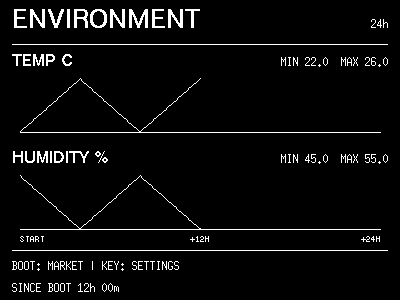

# 环境记录与偏好备份

以下功能从 v0.34.0 提供；旧版设备需先更新固件。

## 查看环境趋势

短按 `BOOT` 切到 `ENVIRONMENT`，分别查看板载 SHTC3 测得的室内温度、湿度趋势与
最近窗口的最低/最高值。短按 `KEY` 打开设置；不增加长按菜单。环境页也可以在
“常用 → 显示页面”隐藏或调整顺序，隐藏不停止记录。

上图使用演示数据与固件原生字体，由 `scripts/preview-environment.sh` 生成。

正常模式每 30 秒采样，省电模式每 60 秒，启动时立即获取首个样本。每 5 分钟汇总为一组，
内存最多保留 288 组。横轴保持 24 小时比例：新记录从左向右增长，未采集部分留空；
满一天后滚动显示最近 24 小时。每组曲线显示均值，顶部范围取实际样本的极值。
传感器失败、缺失区间留空，SD 恢复记录与本次采集之间不连线，不将首屏缓存或关机期间
补成新读数。设备屏幕的摄氏/华氏遵循普通偏好，网页记录与 CSV 固定使用摄氏；湿度以百分比显示。
门户等既有任务暂停传感器采样时保留空档，不为绘图增加额外采样。

无网络、无卡、RTC 未校准时仍可记录本次开机的数据。底部标注本次记录时长或恢复来源；
没有历史时不会伪装成完整一天。页面至多每分钟刷新，切页或修改相关偏好可立即刷新。

## 网页查看与 CSV

按[设备设置](device-settings.md)打开门户，在“常用 → 环境趋势”查看两条曲线。
展开或点击刷新时读取设备内存，不自动轮询；点击下载 CSV 获得当前 24 小时窗口。
导出无需 SD 卡，不写卡、不重启，也不会上传到项目服务器。

CSV 包含 UTC Unix 时间、相对年龄、有效/失败样本数、温湿度均值与最小/最大值，以及是否
来自恢复。温度固定使用摄氏度；无有效样本时数值留空，时间未知或当前桶遇到校时跳变时
UTC 时间留空。相对年龄不随 RTC 校时跳变，不应将空白数据当成零。

## 可选 microSD 保存

默认关闭。在“常用 → 环境趋势”选择保存方式并确认：

- 关闭：仅在内存记录本次开机的最近 24 小时。
- 最近 24 小时恢复：维护滚动快照，开机时恢复未过期的记录。
- 长期历史（含 24 小时恢复）：额外按月份保存 CSV，不设按天数自动清理。

升级保留原有 24 小时恢复设置，不自动开启长期留存。两种保存都需要可用的 FAT32 卡和
有效 RTC。关闭门户后，停留时钟、月历或环境页且设备空闲时处理；每个完整 5 分钟桶结束后
尝试保存，快照约每 5 分钟更新。音乐播放/暂停、语音、门户、升级等忙碌事务期间延后。
长期历史从开启后的下一个完整桶开始，不将开启之前的内存数据补入永久文件，因此第一条
通常需要 5–10 分钟，并且需离开门户让后台完成写卡。重新打开门户可以查看保存状态。

- 快照维护 `rlcd/environment/history-0.bin`、`history-1.bin` 与固定的临时文件
  `.history-pending.tmp`；长期历史另存为 `rlcd/environment/archive/YYYY-MM.csv`，按 UTC
  月份划分。不格式化卡、不清理其他目录。
- 两个历史槽带完整性校验，先写临时文件、同步回读，再替换目标槽。启动时仅合并可信 RTC
  下未过期、非未来的有效记录，不覆盖本次已采集的数据。
- 在“SD 历史文件”按月份分页查看并下载 CSV，最新月份在前；下载在本地完成，不上传服务器。
  播放音乐时请先停止再读取历史，下载不会强制中断播放。关闭保存后仍可下载已有文件。
  CSV 使用摄氏温度和百分比湿度（两位小数），包含 UTC 时间、样本数、极值和完整性校验；
  没有有效读数的温湿度字段留空。通常一年约 10–12 MB，实际随开机时长和行长变化。
- 卡内至少预留 16 MiB 空闲空间；空间不足时停止新增历史并提示，不自动删除旧记录。
  没有按年限清理，但卡容量、介质寿命和异常文件限制仍适用，不承诺永久可靠保存。
  为防异常文件拖住设备，单月文件上限 8 MiB、目录扫描最多 4096 项；超限保留原文件，
  关机后可使用电脑备份处理。正常每月约 1 MB，不会因这些保护限制而只保留最近几个月。
- 关闭保存只停止后续写入，不删除卡上旧记录。没有卡或保存失败时继续 RAM 记录；
  普通偏好备份不会自动改变两个保存开关。长期忙碌超过内存窗口时，过期的未保存数据无法补写。
- 正常关机或突然断电均可能丢失尚未落卡的数据；5 分钟是尝试保存的节奏，不是最大丢失保证。
  FAT32 和损坏卡的底层 I/O 不能保证断电安全或固定完成时间；首次查询卡内空闲空间也可能
  较慢。任务在检查点取消/让步，这不是底层读写的硬超时，不承诺所有故障自动修复。
- 若断电留下不足以识别来源的临时文件，固件会保守停止覆盖。关机取卡、备份
  `rlcd/environment/` 后，可手动移走对应异常文件再试；不要在运行中插拔卡。

长期断电与慢卡表现仍需实机验证，不作为重要环境测量的唯一备份。

## 采样频率的考虑

环境设备没有统一的强制采样周期。例如 [SwitchBot 温湿度计](https://support.switch-bot.com/hc/en-us/articles/25328810947351-SwitchBot-Meter-Data-Update-Frequency)
区分 4 秒采集与 1 分钟历史保存，[ESPHome SHTCx](https://esphome.io/components/sensor/shtcx/)
默认更新间隔为 60 秒，[Airthings View](https://help.airthings.com/en/articles/5405179-view-how-often-does-view-take-measurement-samples)
的温湿度间隔为 2.5 分钟。室内趋势不需要秒级历史，本项目选择 30/60 秒采样与 5 分钟聚合，
兼顾当前读数和长期变化。首屏采用三个近期有效样本滤波，短失败保留已有读数，持续失败达到
180 秒后失效；历史不重复记录这些缓存值。

[SHTC3 数据手册](https://sensirion.com/file/datasheet_shtc3)中的传感器响应时间不等于数字读数
转换时间，实际还受外壳与安装影响。降低采样次数不代表整机续航按比例增加；功耗结论仍需实测。

## 普通偏好备份与恢复

在“维护 → 偏好备份”导出 JSON，可在同一 Wi-Fi 授权门户或设备热点操作，无需 SD 卡。
恢复时先选择文件，在浏览器本地校验并查看预览，确认后才发送设备；格式不符、字段重复、
超限或数值无效时拒绝整份导入，不部分覆盖。

备份包含时区、温度单位、媒体音量、页面显隐与顺序、计时自定义值、音乐播放方式及闹钟
规则/音量。不包含 Wi-Fi 密码、API Key、Host、天气/市场/AI 服务配置、图片或歌曲；
也不改变 Beta 通道、手动省电和 SD 自动保存开关。

导入合并到设备当前偏好，成功后无需重启。已有未保存表单草稿保留并提示；因此草稿可能
不同于刚导入的设备值，确认后再保存。网络中断时先重新读取核对结果，不自动重复导入。
闹钟开关与规则属于备份内容，确认前请检查预览中的闹钟设置和设备时间。
